# 饭点 · Campus Bites

> 今天吃什么？把纠结，留给我们。

一份使用 AI Coding 辅助开发的校园食堂点评推荐演示作品。围绕学生“选餐困难、发现新菜、参考评价”的场景，把 **筛选 → 推荐 → 看详情 → 记录用餐 → 餐后点评** 连成可体验的流程。

**[在线体验](https://wangneverstop.github.io/campus-bites/)** · **[使用帮助](https://wangneverstop.github.io/campus-bites/#about)**

无需登录。支持桌面和手机布局。当前为静态交互原型，校园、窗口、价格与初始评价均为虚构示例；新增数据仅保存在当前浏览器。

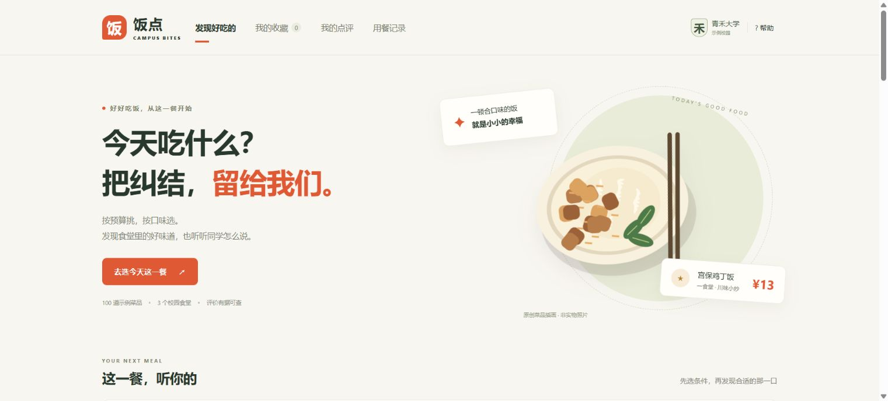

## 两分钟体验

1. 在首页设置预算、口味和用餐时段，或搜索菜名、窗口。
2. 点击“帮我选一个”或“换一批”，从满足条件的菜品中找到候选。
3. 打开详情，查看位置、标价、评分和评价；也可以收藏稍后再看。
4. 点击“就吃这道”，保存待用餐计划；到“用餐记录”确认已用餐，查看今日消费。
5. 写下一条点评，再到“我的点评”查看或编辑。刷新后可检查本浏览器保存效果。

## 功能一览

| 模块 | 已实现内容 | 解决的问题 |
|---|---|---|
| 发现与筛选 | 100道示例菜品、3个食堂、7个窗口；搜索、食堂/预算/口味/餐次/品类组合筛选 | 缩小选择范围 |
| 随机推荐 | 单道抽选、每批最多3道、可反复换批、候选不足时明确提示 | 减少反复纠结 |
| 浏览排序 | 综合参考、评分降序、价格升序、新品优先；20项递增加载 | 方便比较而不一次铺满页面 |
| 详情与反馈 | 菜品评分、评价数量、分项评分、标签、窗口位置、同窗口菜品 | 让判断有具体依据 |
| 点评与收藏 | 本地保存/编辑点评、收藏列表、空状态引导 | 留住体验与想吃的菜 |
| 用餐记录 | 待用餐、确认/撤回已用餐、补记历史用餐 | 区分计划和实际记录 |
| 消费统计 | 今日已用餐标价合计、今日待用餐金额、累计已用餐金额 | 明确统计范围 |
| 使用帮助 | 操作指南、示例数据说明、存储与访问提示 | 让使用边界清晰 |

## 页面截图

以下均为2026年11月10日实际网页截图，不是设计效果图。随机结果会变化；收藏、我的点评和用餐记录展示空状态，未为截图添加虚构的个人用餐或评价记录。

### 组合筛选与关键词搜索

食堂、预算、口味和用餐时段并列；可叠加菜品种类和关键词。条件没有结果时显示空状态，不擅自放宽条件。

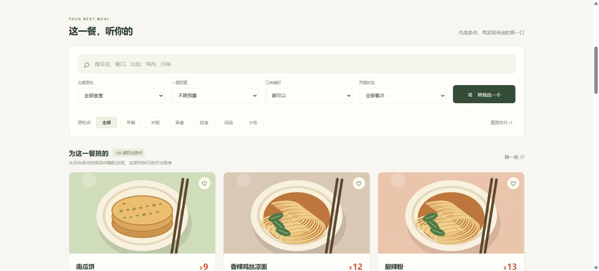

### 随机选菜

从当前符合条件的菜品中抽选，展示价格、选择理由和窗口位置；“再选一道”在候选充足时避免立即重复。

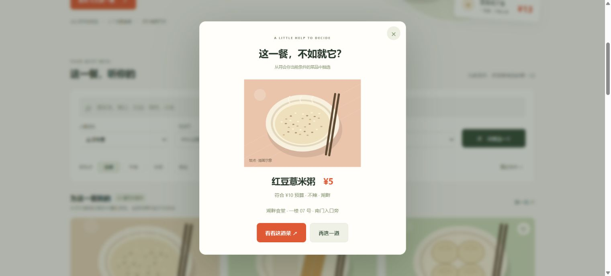

### 菜品详情与窗口位置

展示插画、标价、口味、总体评分、评价数和窗口位置。操作顺序为“就吃这道—收藏—写下这一餐的评价”。

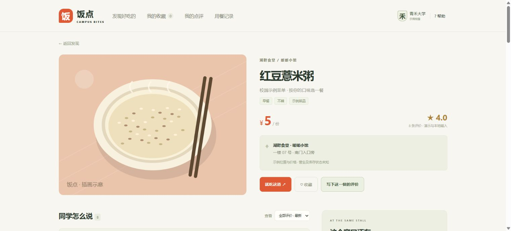

### 撰写点评

总体评分必填；标签、300字以内文字和口味/分量/性价比分项评分可选。自己的点评可以编辑，仅在本浏览器保存。

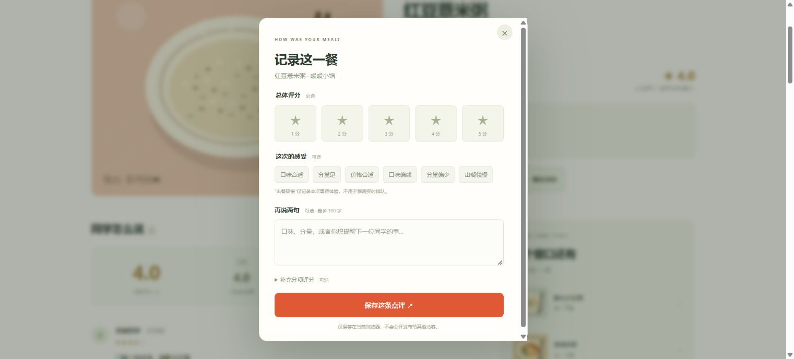

### 确认这一餐

沿用随机选菜的居中卡片风格。保留用餐日期，按设备当前时间建议餐次，固定菜品标价并提醒窗口位置；保存后是待用餐计划。


### 用餐记录与今日消费

展示今日消费、今日待用餐和累计消费。截图为尚未添加记录的真实空状态；待用餐不计入消费，确认已用餐后才计入，支持撤回。金额是记录标价，不是支付账单。

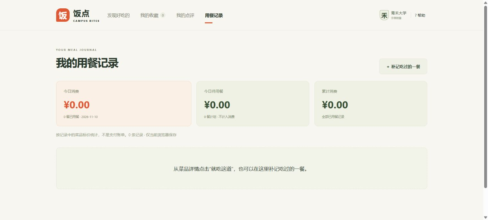

### 补记吃过的一餐

从用餐记录页选择菜品，再确认日期与餐次，可补记已经吃过的饭菜。

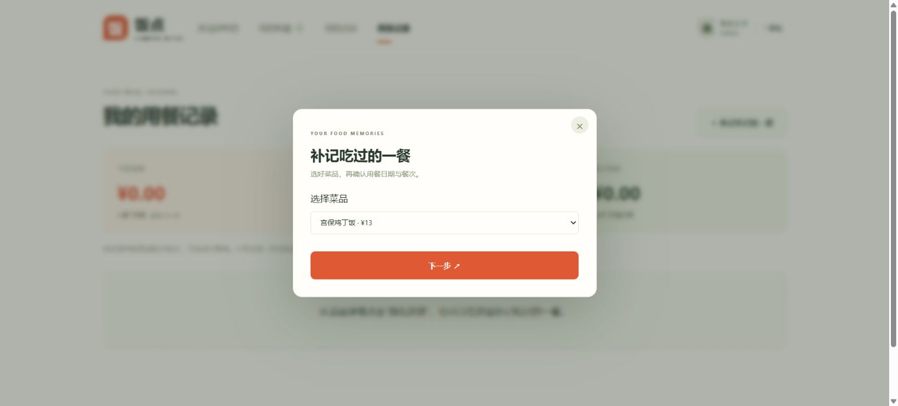

### 我的收藏

集中保存想吃的菜品；截图展示首次使用的空状态和返回发现入口。

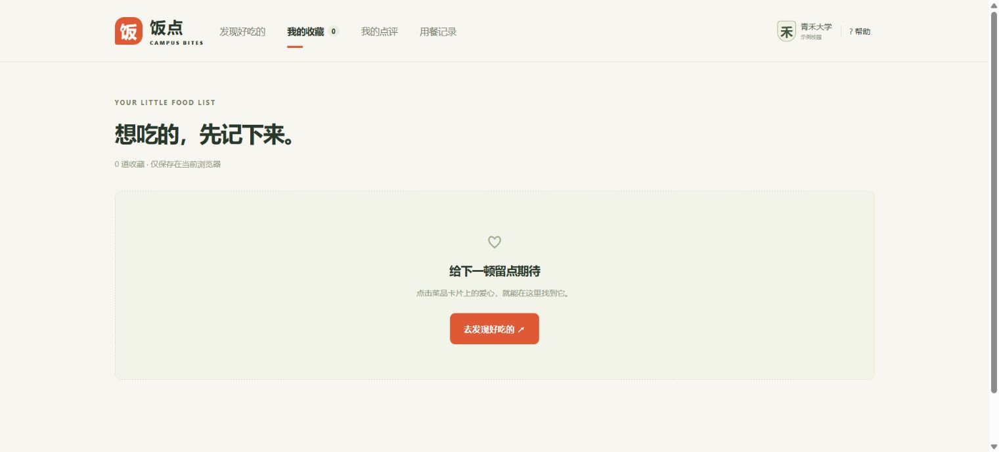

### 我的点评

集中查看和编辑本人在当前浏览器写下的评价；截图为空状态，没有伪造真实食客内容。

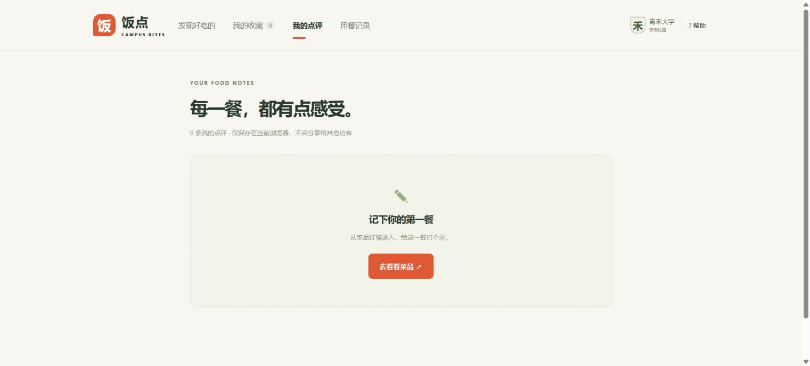

### 帮助与数据说明

提供操作说明、访问问题提示，以及示例数据、评价规则和实现边界说明。

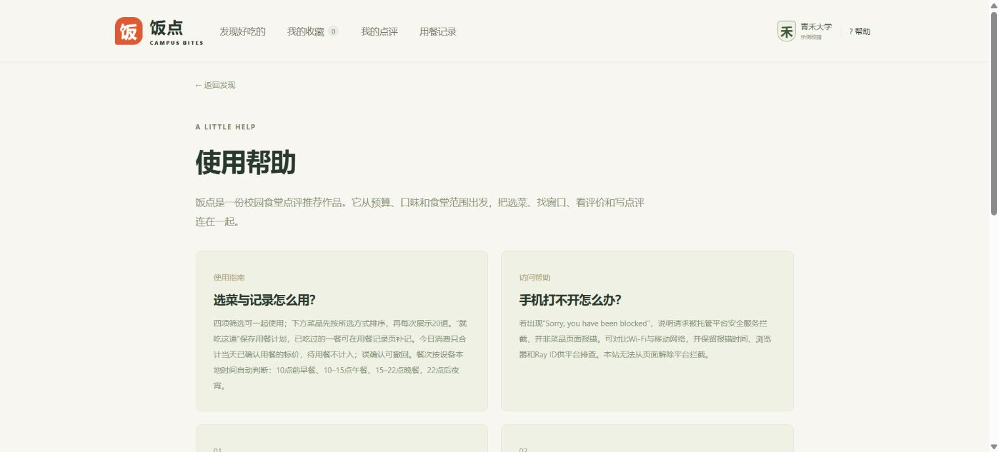

### 近期反馈与全量排序

近期反馈以具体标签提及次数作为参考；综合参考、评分降序、价格升序和新品优先作用于全部筛选结果，再截取展示。

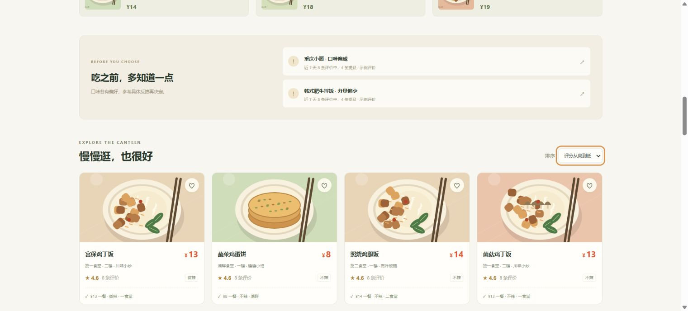

### 每次多看20道菜

默认展示20项，点击查看更多追加20项；变更筛选/排序时重新从前20项开始。截图展示首次加载20项时的列表底部入口。

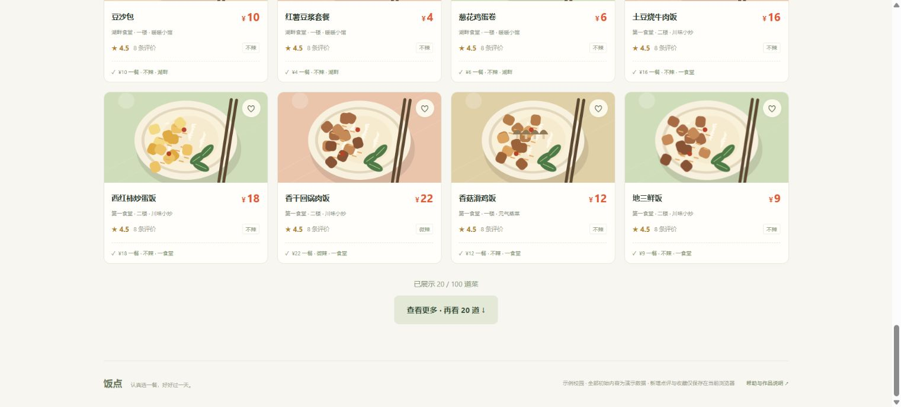

## 关键业务规则

- **先筛选，再推荐**：随机抽选只发生在满足当前条件的候选池中。换批不是顺序翻页；有多于3道候选时尽量避免整批完全重复，但不保证历次抽取永不重复。
- **显示分与排序分区分**：界面星级是有效总体评分的原始均值；综合参考排序使用小样本平滑值 `(评价数 × 均分 + 5 × 4) / (评价数 + 5)`，无评价时参考值为4，不将它展示为真实评分。评分降序则直接按原始均分排列。
- **近期反馈有门槛**：近7天至少5条评价，同一“口味偏咸”或“分量偏少”标签至少3条、且占比≥40%才显示提示。这是演示规则，不能据此认定食品安全问题或给整个窗口下结论。反馈区域在没有符合条件的反馈时仍保留说明。
- **排序先于分页**：先对所有符合条件的菜品排序，再展示前20项；每次追加20项，修改筛选或排序后重置展示数量。
- **餐次按本地时间建议**：00:00–09:59早餐，10:00–14:59午餐，15:00–21:59晚餐，22:00–23:59夜宵。它是打开记录弹窗时的建议，不代表食堂营业状态；补记可手动选择餐次。
- **计划不等于消费**：“就吃这道”先记录待用餐；确认已用餐后按记录日期计入消费。今日消费只统计本地今天且已用餐的记录，金额按分累加。无支付、订单或真实扣款。
- **防误操作**：同日同餐次同菜品的待用餐计划避免重复创建；未来计划不能提前确认已用餐；误确认可撤回。

## AI Coding 与迭代过程

从题目拆解出用户场景和最小功能范围，比较参考方案，再通过AI辅助完成页面、数据与交互实现。根据实际操作反馈继续调整随机换批、反馈空状态、筛选布局、按钮优先级、统一弹窗与消费统计，最后部署并核查访问效果。

这里的“AI Coding”指开发方式。当前推荐由筛选、随机抽选和评分规则完成，没有在网站中调用大模型，也没有把规则提示包装成AI生成的评价摘要。

## 数据与隐私边界

- 青禾大学及食堂/窗口/菜品内容为虚构演示，价格、位置和上新信息未经真实校园核实；菜图是SVG插画，不是实物照片。
- 初始评价是演示数据，显示条数不代表已认证的真实就餐人数；示例评价日期以首次使用时刻为基准，之后随时间自然过期。
- 点评、收藏、筛选偏好和用餐记录使用 `localStorage` 保存在当前浏览器。其他设备和其他访客不会看到新增内容。
- 清除浏览器数据、换浏览器或换域名不会自动保留/迁移上述数据；存储不可用时页面会提示。
- 本版不要求学号、联系方式、地理定位或账号登录；没有共享数据库、实时排队、库存、支付与食品安全认证功能。
- 2026-11-10部署至GitHub Pages后，作者反馈手机可以打开；这不代表已覆盖所有地区、网络和浏览器。

## 技术与文件结构

原生 HTML / CSS / JavaScript（ES Modules），Hash路由，SVG插画，无需npm安装或构建，无外部CDN或模型API依赖。

| 文件 | 职责 |
|---|---|
| index.html | 页面入口、导航、弹窗容器 |
| app.js | 页面渲染、事件、路由、本地状态与交互 |
| data.js | 示例食堂、窗口、菜品与标签 |
| domain.js | 筛选、评分、排序、随机抽选、点评校验 |
| meal.js | 本地日期、餐次、消费汇总与展示数量逻辑 |
| art.js | 菜品SVG插画 |
| styles.css | 页面样式与响应式布局 |
| favicon.svg | 网站图标 |
| 01-home.png … 13-load-more.png | 本README使用的实际页面截图 |

## 本地预览与部署

通过本地HTTP静态服务器打开仓库根目录；不要用双击 `index.html` 的 `file://` 方式验收ES Modules。

例如，已安装Python 3时，在仓库根目录执行：

```sh
python -m http.server 8000
```

然后访问 `http://localhost:8000/`。这只是可选预览方式，网站运行本身不依赖Python。

本仓库使用 GitHub Pages：Settings → Pages → Deploy from a branch → main → / (root)。8个网站文件直接放在仓库根目录。更新main分支后由Pages重新发布，公开地址不变。

## 后续方向（尚未实现）

1. 接入共享数据库、身份归属与防重复机制，让多设备查看同一份点评。
2. 核实真实校园的窗口位置、标价和图片来源，建立维护流程。
3. 在评价来源可靠后，再增加可追溯的评价摘要。

本仓库是作品展示与静态部署版本；本地开发过程中的测试文件未包含在此仓库，不能在这里直接运行开发项目的测试命令。
